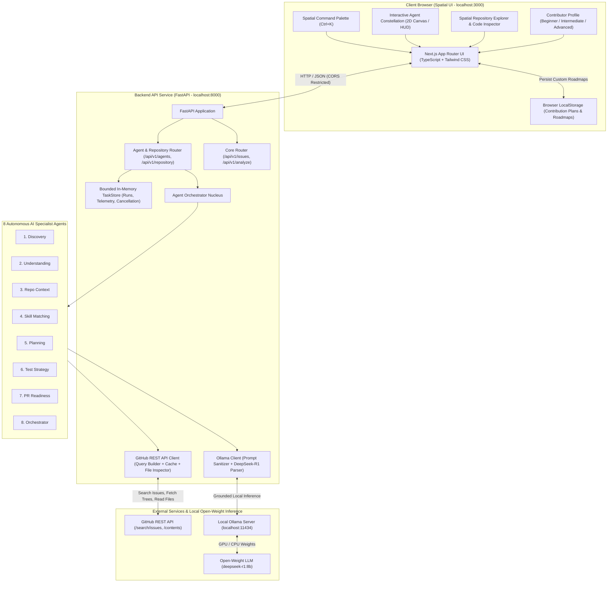

# 🧭 OpenSource Navigator AI

> **Explore open source. Understand the code. Make your first contribution.**  
> *Built for Hacktoberfest Hack Day Pune × NIAT–ADYPU — Best Open-Source AI Project.*

[](LICENSE)
[](https://fastapi.tiangolo.com)
[](https://nextjs.org)
[-purple.svg)](https://ollama.com)
[](#-8-autonomous-ai-specialist-agents)
[](https://microsoft.com)

---

## 🌟 Overview

Contributing to open source for the first time can be intimidating. Beginners are often overwhelmed by massive codebases, cryptic maintainer jargon, and unfamiliar testing practices.

**OpenSource Navigator AI** empowers students and first-time contributors with a **Spatial Developer Workspace** and an **Autonomous 8-Agent AI System**:

1. **8 Autonomous AI Specialist Agents:** An interactive 2D orbital constellation coordinating 8 typed specialist agents (Discovery, Understanding, Repo Context, Skill Matching, Planning, Test Strategy, PR Readiness, Orchestrator) over local open-weight models.
2. **Spatial UI & Quick Command Palette:** Dark developer HUD, responsive layouts, live agent telemetry pulses, and instant keyboard command palette (`Ctrl+K` / `⌘K`).
3. **Repository Context Explorer:** Live file tree inspector for any target GitHub repo, displaying verified files, test suites, and contributor guidelines vs. AI hypotheses.
4. **Discover Real Public GitHub Issues:** Live search filtered by language, topic, tags (`good first issue`, `help wanted`), and target repository (`owner/repo`), excluding pull requests and with pagination.
5. **Customizable Contribution Roadmaps & PR Export:** Converts AI insights into interactive checklists. Contributors can add custom tasks, track progress, and **Export to Markdown** with 1-click for GitHub PR descriptions!
6. **Zero Paid APIs or Cloud Lock-in:** 100% functional with local open-weight AI models (`deepseek-r1:8b`, `qwen3:4b`).

---

## 🤖 8 Autonomous AI Specialist Agents

| Agent Name | Role | Primary Objective | Key Outputs |
| :--- | :--- | :--- | :--- |
| **Orchestrator** | `orchestrator` | Coordinates pipeline, checks cancellation, preserves partial outputs | Consolidated workflow intelligence |
| **Issue Discovery Agent** | `discovery` | Curates good-first-issues and student tasks from GitHub REST API | Issue items, difficulty rating, recommended labels |
| **Issue Understanding Agent** | `understanding` | Translates cryptic maintainer jargon into plain-English explanations | Summary, root problem breakdown, expected outcome |
| **Repository Context Agent** | `repo_context` | Inspects verified file trees, test suites, and contributor guidelines | Verified files, contributing guide URL, test directories |
| **Skill Matching Agent** | `skill_matching` | Maps required languages, frameworks, prerequisites, and learning curves | Required skills, prerequisite concepts, difficulty estimate |
| **Contribution Planning Agent** | `planning` | Builds step-by-step investigation, code, and debugging milestones | Preparation steps, implementation steps, common pitfalls |
| **Test Strategy Agent** | `test_strategy` | Formulates reproduction steps, regression cases, and test assertions | Reproduction steps, test file suggestions, assertions |
| **PR Readiness Agent** | `pr_readiness` | Constructs commit guidelines, PR descriptions, and sanity checklists | PR title, draft description, checklist items |

---

## 🏗️ Architecture



---

## 🚀 Quick Start Guide (Windows PowerShell)

### Prerequisites
- **Node.js** v18+ (tested on Node v24)
- **Python** 3.10+ (tested on Python 3.10.11)
- **Git**
- **Ollama** ([Download from Ollama.com](https://ollama.com)) with `deepseek-r1:8b` or `qwen3:4b`

### 1. Run Automated Setup
Open Windows PowerShell in the project directory:

```powershell
cd D:\OpenSourceNavigatorAI
.\scripts\setup.ps1
```

### 2. Launch Services
Start both backend (port 8000) and frontend (port 3000):

```powershell
.\scripts\run.ps1
```

Access the application:
- 🌐 **Spatial Frontend Dashboard:** [http://localhost:3000](http://localhost:3000)
- ⚙️ **FastAPI Swagger Docs:** [http://localhost:8000/docs](http://localhost:8000/docs)
- 🩺 **Health Endpoint:** [http://localhost:8000/api/v1/health](http://localhost:8000/api/v1/health)

### 3. Run Automated Tests
```powershell
# Backend automated tests (32 passed: reliability, cancellation, context propagation, rate limits, schema validation)
cd D:\OpenSourceNavigatorAI\backend
.\.venv\Scripts\python -m pytest -v

# Frontend unit & regression tests (12 passed: storage synthesis, task lifecycle, API client reliability)
cd D:\OpenSourceNavigatorAI\frontend
npm test

# Frontend linting (0 errors, 0 warnings)
npm run lint

# Frontend production build verification
npm run build
```

### 4. Stop Services
When finished:

```powershell
.\scripts\stop.ps1
```

---

## 🔧 Environment Configuration

### Backend (`backend/.env` or `.env.example`)
| Variable | Default | Description |
|---|---|---|
| `OLLAMA_BASE_URL` | `http://localhost:11434` | Ollama HTTP API endpoint |
| `OLLAMA_MODEL` | `deepseek-r1:8b` | Configurable local open-weight model (e.g. `llama3:8b`, `deepseek-r1:8b`, `qwen2.5-coder:7b`) |
| `OLLAMA_TIMEOUT_SECONDS` | `120.0` | Timeout threshold for inference |
| `GITHUB_TOKEN` | *(empty / optional)* | Personal access token for 5,000 req/h rate limits (unauthenticated: 60 req/h) |
| `CORS_ORIGINS` / `FRONTEND_ORIGIN` | `http://localhost:3000` | Allowed client origins (comma-separated or single string) |

### Frontend (`frontend/.env.local`)
| Variable | Default | Description |
|---|---|---|
| `NEXT_PUBLIC_API_BASE_URL` | `http://localhost:8000` | Target FastAPI backend URL |

---

## 💡 Reliability & Truthful AI Design Principles

1. **Truthful Model Reporting:** The application dynamically detects and reports the active Ollama model. If Ollama is offline or the model is missing, the backend degrades gracefully to deterministic rule-based guidance clearly tagged as `[Rule-Based Guidance (Offline Fallback)]`, never fabricating model telemetry.
2. **Cooperative Cancellation & Safe Retries:** Multi-agent workflows verify cancellation tokens before and after every specialist agent. Retries discard cancellation flags, reset status cleanly, and preserve the original user request payload.
3. **Evidence vs. Hypothesis Provenance:** Every task in the Contribution Map distinguishes between verified GitHub facts (`[Verified from GitHub]`), AI-inferred recommendations (`[Inferred by AI]`), and unexecuted test plans (`[Proposed]`).
4. **Resilient In-Memory Task Store:** Workflow execution records are maintained in a thread-safe in-memory task store with bounded retention (latest 50 runs), while custom Contribution Maps and task tracking persist in the contributor's browser `localStorage`.

---

## 🏆 Hackathon Submission Notes

- **Event:** Hacktoberfest Hack Day Pune × NIAT–ADYPU
- **Prize Category:** Best Open-Source AI Project
- **Documentation:**
  - 📐 [System Architecture](docs/architecture.md)
  - 🤖 [Multi-Agent Workflow Specification](docs/agent-workflow.md)
  - 🎬 [Judge Live Demo Script](docs/demo-script.md)

---

## 📜 License

MIT License. See [LICENSE](LICENSE) for details.
