# OpenSource Navigator AI — Multi-Agent System & Workflow Architecture

OpenSource Navigator AI features an autonomous, typed multi-agent system composed of **8 specialist AI agents** orchestrated over local open-weight language models.

---

## 1. Multi-Agent Roster

| Agent Name | Role | Primary Objective | Key Outputs |
| :--- | :--- | :--- | :--- |
| **Orchestrator** | `orchestrator` | Pipeline coordinator, state persistence, cancellation management | Orchestration state, combined intelligence artifact |
| **Issue Discovery Agent** | `discovery` | Curates good-first-issues and student tasks from GitHub REST API | Issue items, difficulty rating, recommended labels |
| **Issue Understanding Agent** | `understanding` | Translates cryptic maintainer jargon into plain-English explanations | Summary, root problem breakdown, expected outcome |
| **Repository Context Agent** | `repo_context` | Inspects verified file trees, test suites, and contributor guidelines | Verified files, contributing guide URL, test directories |
| **Skill Matching Agent** | `skill_matching` | Maps required languages, frameworks, prerequisites, and learning curves | Required skills, prerequisite concepts, difficulty estimate |
| **Contribution Planning Agent** | `planning` | Builds step-by-step investigation, code, and debugging milestones | Preparation steps, implementation steps, common pitfalls |
| **Test Strategy Agent** | `test_strategy` | Formulates reproduction steps, regression cases, and test assertions | Reproduction steps, test file suggestions, assertions |
| **PR Readiness Agent** | `pr_readiness` | Constructs commit guidelines, PR descriptions, and sanity checklists | PR title, draft description, checklist items |

---

## 2. Agent Orchestration Pipeline

```mermaid
sequenceDiagram
    autonumber
    actor User as Contributor (Spatial UI)
    participant Orchestrator as Orchestrator Agent
    participant TaskStore as TaskStore (Bounded In-Memory)
    participant Discovery as Issue Discovery Agent
    participant Understanding as Issue Understanding Agent
    participant RepoContext as Repository Context Agent
    participant SkillMatch as Skill Matching Agent
    participant Planning as Contribution Planning Agent
    participant TestStrategy as Test Strategy Agent
    participant PRReadiness as PR Readiness Agent
    participant Ollama as Local Open-Weight LLM (deepseek-r1:8b)

    User->>Orchestrator: POST /api/v1/agents/runs (Issue & Repo payload)
    Orchestrator->>TaskStore: Create WorkflowRunRecord (status: RUNNING)
    Orchestrator-->>User: Return run_id for live UI telemetry

    rect rgb(20, 30, 45)
        note over Orchestrator, Discovery: Phase 1: Discovery & Context Gathering
        Orchestrator->>Discovery: Run discovery query if needed
        Orchestrator->>RepoContext: Fetch real repository layout via GitHub API
        RepoContext-->>Orchestrator: Verified files, CONTRIBUTING.md, test dirs
    end

    rect rgb(25, 35, 55)
        note over Orchestrator, Understanding: Phase 2: Understanding & Skill Evaluation
        Orchestrator->>Understanding: Synthesize plain-English problem breakdown
        Understanding->>Ollama: Generate structured problem summary
        Ollama-->>Understanding: JSON payload
        Orchestrator->>SkillMatch: Evaluate required competencies & match contributor level
        SkillMatch->>Ollama: Generate skill alignment assessment
        Ollama-->>SkillMatch: JSON payload
    end

    rect rgb(20, 45, 35)
        note over Orchestrator, Planning: Phase 3: Actionable Contribution Roadmap
        Orchestrator->>Planning: Generate milestone checklists & inspection hypotheses
        Planning->>Ollama: Synthesize investigation & implementation milestones
        Ollama-->>Planning: JSON payload
        Orchestrator->>TestStrategy: Formulate verification & test cases
        TestStrategy->>Ollama: Generate test assertions & reproduction strategy
        Ollama-->>TestStrategy: JSON payload
        Orchestrator->>PRReadiness: Prepare PR template & final review checklist
        PRReadiness->>Ollama: Construct PR description & sanity checks
        Ollama-->>PRReadiness: JSON payload
    end

    Orchestrator->>TaskStore: Update run status to COMPLETED with unified intelligence
    User->>TaskStore: GET /api/v1/agents/runs/{run_id} (Poll updates)
    TaskStore-->>User: Full multi-agent execution telemetry & outputs
```

---

## 3. Grounding & Safety Guarantees

1. **Verified Real Files vs. Hypotheses:**
   - The **Repository Context Agent** verifies whether files exist in the target repository using GitHub's REST API.
   - Any file path or directory suggested by the AI that is not confirmed in the repository tree is explicitly flagged as a `hypothesis` to protect beginners from searching for nonexistent files.

2. **Untrusted Input Isolation:**
   - All external GitHub titles, descriptions, and comments are treated as untrusted user data and enclosed in strict parsing blocks.
   - DeepSeek R1 `<think>` reasoning tags are stripped cleanly via regex before JSON schema parsing.

3. **Graceful Cancellation & Resilience:**
   - The user can cancel a running workflow at any time via `POST /api/v1/agents/runs/{run_id}/cancel`.
   - The Orchestrator checks cancellation tokens before invoking each specialist agent.
   - Partial outputs from completed agents are preserved even if a later step fails or gets cancelled.

4. **100% Local Inference:**
   - Zero commercial cloud APIs or subscription keys are required.
   - All agent interactions run against the locally hosted Ollama inference server (`deepseek-r1:8b`).
