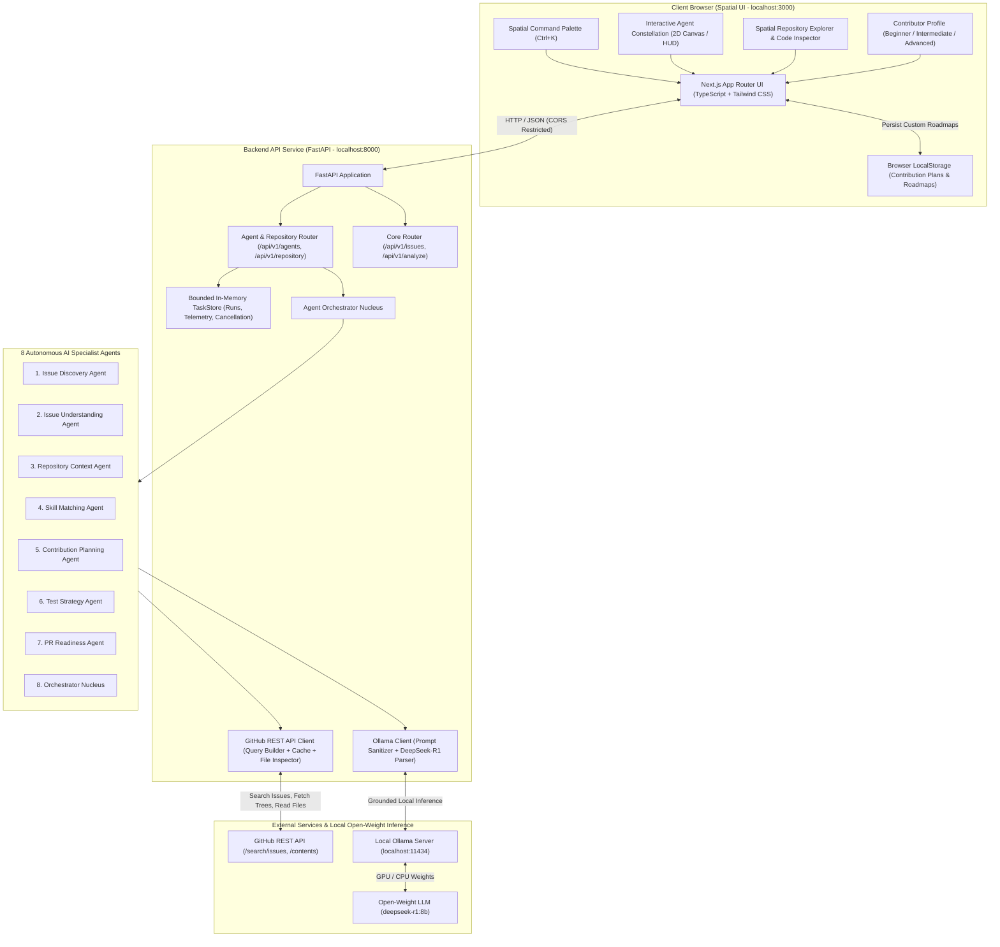

# OpenSource Navigator AI — System Architecture

**OpenSource Navigator AI** is a spatial developer workspace and multi-agent AI system engineered for students and beginner developers making their first open-source software contributions.

---

## 1. High-Level Architecture Diagram

---

## 2. Component Breakdown

### Frontend (`/frontend`)
- **Framework:** Next.js 16 with App Router, React 19, TypeScript.
- **Styling:** Tailwind CSS (Dark spatial developer palette, responsive layout, subtle gradients).
- **Icons:** Lucide React icons.
- **Key Modules:**
  - `components/AgentConstellation.tsx`: Interactive 2D constellation map displaying the 8 specialist agents with real-time status pulses (`idle`, `running`, `completed`, `failed`).
  - `components/AgentStudio.tsx`: Full pipeline orchestration, single-agent runner, live telemetry, and agent inspector drawer with typed I/O schemas and output payload JSON copy.
  - `components/RepositoryExplorer.tsx`: Tree explorer for any target repository, live file content viewer with size limits, test directory indicators, and distinction between verified files and AI hypotheses.
  - `components/SpatialCommandPalette.tsx`: Global keyboard shortcut (`Ctrl+K` or `⌘K`) for rapid navigation and action dispatching.
  - `components/ActivityView.tsx`: Real-time workflow telemetry feed with durations, error traces, and cancellation/retry actions.
  - `components/RoadmapView.tsx`: Spatial timeline, custom task additions/deletions, and 1-click Markdown export (`Copy MD` and `Download .md`).
  - `lib/storage.ts`: Safe client-side persistence for contribution checklists.

### Backend (`/backend`)
- **Framework:** Python 3.10+ with FastAPI.
- **Data Validation:** Pydantic models for strict payload validation.
- **Concurrency & State:** Thread-safe, bounded in-memory `TaskStore` with cancellation token support and background worker execution.
- **Testing:** Pytest with 24 automated unit tests covering all routes, agents, schemas, and resilience fallbacks.

### Specialist AI Agents (`app.agents`)
- **Orchestrator (`orchestrator`):** Coordinates pipeline execution, passes outputs downstream, checks cancellation state.
- **Issue Discovery (`issue_discovery`):** Curates good-first-issues and student tasks from GitHub.
- **Issue Understanding (`issue_understanding`):** Breaks down cryptic maintainer jargon into plain English.
- **Repository Context (`repository_context`):** Retrieves verified file trees and contributor guides (`CONTRIBUTING.md`).
- **Skill Matching (`skill_matching`):** Maps prerequisites, required skills, and matches contributor proficiency.
- **Contribution Planning (`contribution_planning`):** Synthesizes investigation, implementation, and pitfall checklists.
- **Test Strategy (`test_strategy`):** Outlines reproduction steps, test assertions, and test directory recommendations.
- **PR Readiness (`pr_readiness`):** Generates PR descriptions, branch naming guidelines, and pre-flight checklists.

---

## 3. Security & Safety Posture

1. **Untrusted Input Isolation:** Issue descriptions and titles from GitHub are treated as untrusted user input. They are encapsulated strictly within delimiter markers and never injected as raw system prompt instructions.
2. **Zero Credential Leakage:** Optional `GITHUB_TOKEN` values are kept strictly server-side in environment variables and are never surfaced to the client or committed to Git.
3. **Explicit Verification vs Hypothesis:** The AI analyzer transparently flags unverified files as hypotheses while citing verified files that actually exist in the target repo.
4. **No Code Execution:** The system never executes code from untrusted repositories or submits automatic pull requests.
