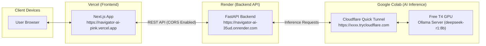

# ☁️ Production Cloud Deployment Guide

This guide details how to make **OpenSource Navigator AI** fully production-ready in the cloud with zero dependencies on your local machine.

---

## 🏗️ Cloud Architecture Overview



---

## 📋 Step 1: Configure Render Backend Environment

Go to your [Render Dashboard](https://dashboard.render.com/) → Select your service (`navigator-ai-backend` / `navigator-ai-35ud`) → **Environment**.

Add or update the following Environment Variables:

| Key | Recommended Value | Why It Is Critical |
| :--- | :--- | :--- |
| `FRONTEND_ORIGIN` | `https://navigator-ai-pink.vercel.app` | Allows your Vercel frontend to call the API without CORS errors |
| `CORS_ORIGINS` | `https://navigator-ai-pink.vercel.app,http://localhost:3000` | Allows both deployed Vercel and local testing |
| `OLLAMA_BASE_URL` | `<Colab-Tunnel-URL>` *(from Step 3)* | Points backend to Google Colab for AI inference |
| `OLLAMA_MODEL` | `deepseek-r1:8b` | Configures the open-weight model |
| `GITHUB_TOKEN` | *(Optional GitHub PAT)* | Increases GitHub API rate limit from 60 to 5,000 req/hr |

> Render will automatically trigger a re-deploy after saving environment variables.

---

## 📋 Step 2: Configure Vercel Frontend Environment

Next.js embeds `NEXT_PUBLIC_*` variables into the static bundle **at build time**.

1. Go to your [Vercel Dashboard](https://vercel.com/) → Select `navigator-ai-pink` → **Settings** → **Environment Variables**.
2. Add a new variable:
   - **Key:** `NEXT_PUBLIC_API_BASE_URL`
   - **Value:** `https://navigator-ai-35ud.onrender.com`
   - **Environments:** Select *Production*, *Preview*, and *Development*.
3. Click **Save**.
4. **Crucial:** Go to the **Deployments** tab → Click the three dots `...` on the latest deployment → Select **Redeploy**. *(This ensures the frontend builds with the new backend URL).*

---

## 📋 Step 3: Run Ollama with GPU on Google Colab

Google Colab provides a free NVIDIA T4 GPU that can run `deepseek-r1:8b` or `qwen2.5-coder:7b` with high token generation speeds.

### 1. Create a New Colab Notebook
1. Open [Google Colab](https://colab.research.google.com/).
2. Click **New Notebook**.
3. In the top menu, go to **Runtime** → **Change runtime type** → select **T4 GPU** → Click **Save**.

### 2. Copy and Run This All-In-One Script
Paste this into the first code cell and click **Run**:

```python
# ========================================================
# OpenSource Navigator AI - Cloud GPU Ollama Runner
# ========================================================

# 1. Install Ollama & Cloudflared Tunnel
!curl -fsSL https://ollama.com/install.sh | sh
!wget -q -nc https://github.com/cloudflare/cloudflared/releases/latest/download/cloudflared-linux-amd64.deb
!dpkg -i cloudflared-linux-amd64.deb

# 2. Start Ollama Daemon in the background
import subprocess
import time
import re

print("\n🚀 Starting Ollama background server...")
ollama_proc = subprocess.Popen(["ollama", "serve"])
time.sleep(4)

# 3. Pull deepseek-r1:8b (or qwen2.5-coder:7b)
print("\n📥 Downloading open-weight model (deepseek-r1:8b)...")
!ollama pull deepseek-r1:8b

# 4. Start Cloudflare Tunnel (100% Free, No Login, No CORS blockage)
print("\n🌐 Creating public tunnel for Render backend...")
tunnel_proc = subprocess.Popen(
    ["cloudflared", "tunnel", "--url", "http://localhost:11434"],
    stdout=subprocess.PIPE,
    stderr=subprocess.STDOUT,
    text=True
)

# Extract and display the public HTTPS URL
public_url = None
for line in tunnel_proc.stdout:
    match = re.search(r"https://[a-zA-Z0-9-]+\.trycloudflare\.com", line)
    if match:
        public_url = match.group(0)
        break

print("\n" + "="*60)
print(f"🎉 YOUR OLLAMA CLOUD URL IS:\n{public_url}")
print("="*60)
print("\n👉 Now copy this URL and paste it into Render Environment Variables:")
print(f"   Key:   OLLAMA_BASE_URL")
print(f"   Value: {public_url}")
print("="*60)

# Keep the cell running
try:
    while True:
        time.sleep(60)
except KeyboardInterrupt:
    print("Stopping tunnel and Ollama...")
    tunnel_proc.terminate()
    ollama_proc.terminate()
```

---

## 🔍 Step 4: Verification & Smoke Test

Once you set `OLLAMA_BASE_URL` in Render:

1. Test Render Backend Health:
   ```bash
   curl https://navigator-ai-35ud.onrender.com/api/v1/health
   ```
   You should see:
   ```json
   {
     "status": "healthy",
     "system_health": "healthy",
     "ollama": {
       "connected": true,
       "configured_model": "deepseek-r1:8b",
       "model_available": true
     }
   }
   ```

2. Open your live Vercel application:
   [https://navigator-ai-pink.vercel.app](https://navigator-ai-pink.vercel.app)
   - Status bar will display **`Ollama: Online`** and **`8 Agents Ready`**.
   - You can search issues, inspect repos, and run AI issue analyses 100% in the cloud!
